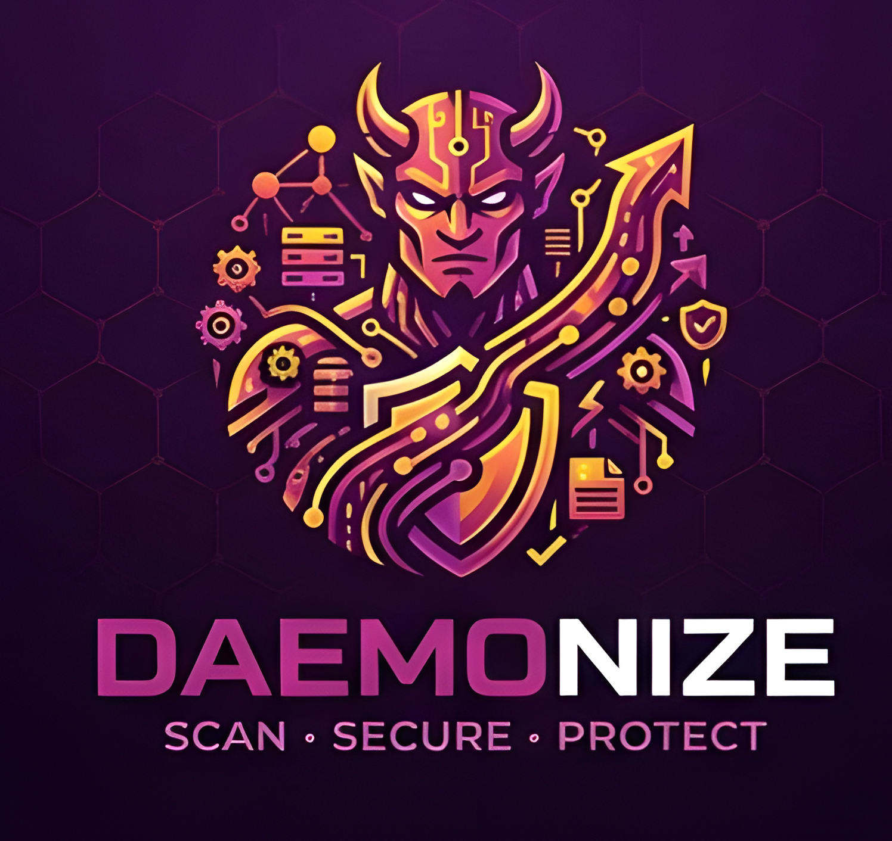
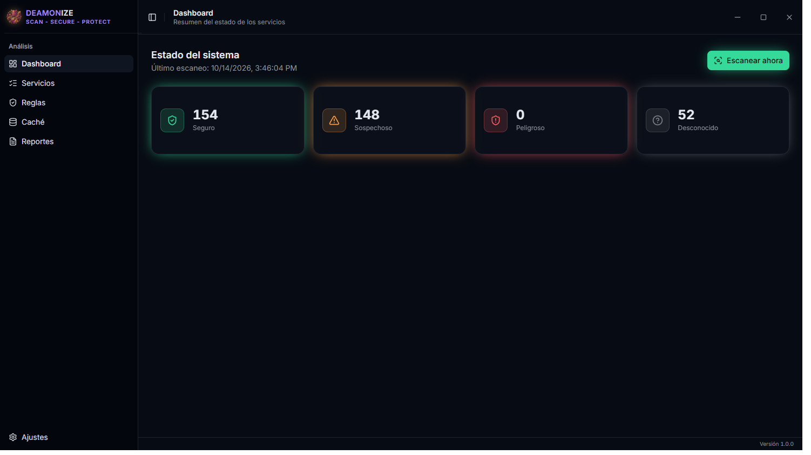
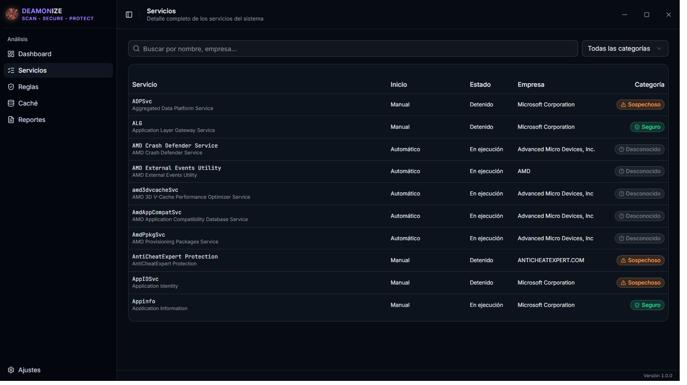
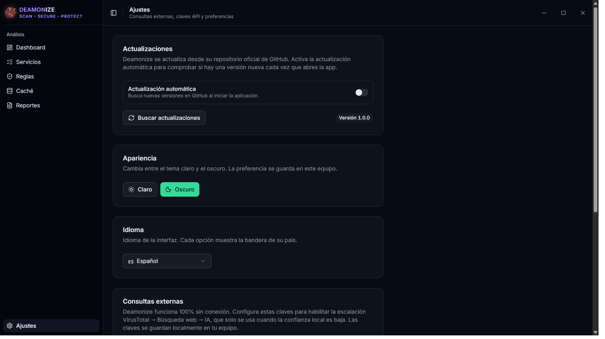

<p align="center">
  <a href="README.md">English</a> | <strong>Español</strong>
</p>

<p align="center">
  
</p>

<h1 align="center">DEAMONIZE</h1>

<p align="center">
  <strong>SCAN · SECURE · PROTECT</strong>
</p>

<p align="center">
  Analizador de seguridad de escritorio para servicios de Windows.<br/>
  Clasifica cada servicio de tu sistema como seguro, sospechoso, peligroso o desconocido — 100% sin conexión por defecto.
</p>

<p align="center">
  <a href="https://github.com/jupaman-GH/Deamonize/releases/latest"></a>
  
  
  
</p>

---

## Descripción general

**Deamonize** es una aplicación de escritorio sin bordes construida con **Tauri 2** que inspecciona los servicios instalados en tu equipo Windows y clasifica cada uno con un motor de riesgo local:

- **Motor de clasificación local** — reglas de lista blanca/negra, verificación de firmantes, heurísticas del binario (sin firma, nombres que imitan al sistema, rutas sin comillas, ejecución desde carpetas de usuario, spoofing del PE) y hashing SHA-256.
- **Escalación externa escalonada** — cuando la confianza local es baja, puede consultar **VirusTotal → Búsqueda web → IA** con tus propias claves API (opcional, todo se queda en tu equipo).
- **Editor de reglas** — gestiona reglas de lista blanca, negra y gris por nombre, ruta, firmante o hash.
- **Caché e historial** — los resultados se cachean con TTL, los escaneos se guardan y se pueden comparar para detectar cambios entre dos puntos en el tiempo.
- **Reportes exportables** — HTML autocontenido (compartible) y JSON legible por máquina con la evidencia y las fuentes de cada veredicto.
- **UI moderna** — ventana sin borde con pantalla de carga animada, temas claro/oscuro, interfaz en inglés/español y la marca morada `DEAMONIZE`.

## Capturas de pantalla

| Dashboard | Servicios |
| :---: | :---: |
|  |  |

| Ajustes |
| :---: |
|  |

## Actualización automática

Deamonize puede actualizarse por sí solo desde las **GitHub Releases** de este repositorio:

1. Abre **Ajustes → Actualizaciones** y activa **Actualización automática**.
2. En cada arranque la app comprueba en segundo plano si hay una versión más nueva y te avisa.
3. También puedes pulsar **Buscar actualizaciones** manualmente; la app descarga el instalador y lo aplica.

Los paquetes de actualización van firmados criptográficamente y la clave pública está embebida en la app — se rechaza cualquier cosa no firmada.

## Instalación

Descarga e instala el instalador desde la [última release](https://github.com/jupaman-GH/Deamonize/releases/latest):

- `Deamonize_1.0.1_x64-setup.exe` — instalador NSIS (por usuario, recomendado)
- `Deamonize_1.0.1_x64_en-US.msi` — instalador MSI (para despliegues gestionados)

> Los instaladores aún no están firmados digitalmente, así que Windows SmartScreen puede mostrar una advertencia. Elige *Más información → Ejecutar de todos modos*.

## Stack tecnológico

- **Frontend** — React 19, TypeScript, Vite, Tailwind CSS 4, componentes shadcn/ui
- **Backend** — Rust, Tauri 2, rusqlite (SQLite), crate `windows` para enumerar servicios y verificar firmas
- **Plugins** — `tauri-plugin-opener`, `tauri-plugin-updater` (GitHub Releases)

## Desarrollo

```bash
npm install
npm run tauri dev      # ejecuta la app en modo desarrollo
npm run tauri build    # genera instaladores y exe portátil en src-tauri/target/release/bundle
```

Requisitos: Node.js 18+, Rust (estable) y los prerrequisitos de Tauri 2 para Windows.

## Donaciones

Estoy desarrollando varios programas más con el objetivo de facilitar
la vida cotidiana de todos. Todo el software en desarrollo será gratuito. 
Las donaciones son la verdadera forma de garantizar que cada moneda que recibe 
el desarrollador sea un reconocimiento genuino y voluntario a su trabajo. 
¡GRACIAS!

[](https://ko-fi.com/friezasama) INVITAME UN CAFE

## Privacidad

Deamonize funciona **100% sin conexión** por defecto: el escaneo, la clasificación, el historial y los reportes nunca tocan la red. Las consultas externas (VirusTotal / búsqueda web / IA) son estrictamente opt-in y solo se ejecutan cuando configuras tus propias claves API en **Ajustes**, que se guardan localmente en tu equipo.

---

<p align="center">Hecho con Tauri · React · Rust</p>
